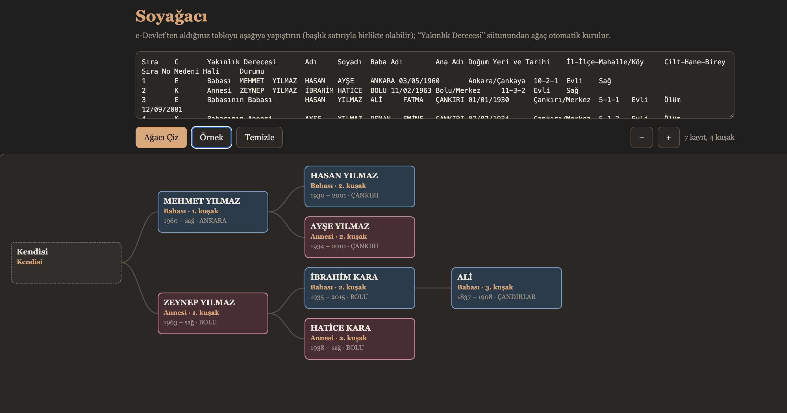

# Soyağacı Görselleştirici

e-Devlet’ten alınan alt-üst soy tablosunu tarayıcıda görsel bir soyağacına dönüştüren, Türkçe ve çevrimdışı çalışabilen basit bir web uygulaması.

## Ekran Görüntüsü

## Özellikler

- Tabloyu başlık satırıyla veya başlık satırı olmadan yapıştırarak ağaç oluşturma
- Anne ve baba tarafındaki akrabaları yakınlık derecesine göre kuşaklar hâlinde gösterme
- Bir kişiyi seçerek kayıtlı bilgilerini görüntüleme
- Ağacı yakınlaştırma ve uzaklaştırma
- Cihazın açık/koyu tema tercihine uyum sağlama
- Örnek veriyle uygulamayı deneme

## Kullanım

1. [index.html](index.html) dosyasını güncel bir web tarayıcısında açın. Kurulum veya sunucu gerekmez.
2. e-Devlet’ten aldığınız tabloyu başlık satırıyla birlikte kopyalayıp giriş alanına yapıştırın. Uygulama sekmeyle ayrılmış tablo verisini bekler.
3. **Ağacı Çiz** düğmesine tıklayın.
4. Bir aile üyesinin kartına tıklayarak ayrıntılarını görüntüleyin. **+** ve **−** düğmeleriyle görünümü ölçeklendirin.

Örnek tabloyu görmek için **Örnek** düğmesini kullanabilir, veriyi ve ağacı sıfırlamak için **Temizle** düğmesine tıklayabilirsiniz.

## Veri ve gizlilik

Uygulama tamamen `index.html` içindeki HTML, CSS ve JavaScript ile çalışır; sunucuya veya harici bir servise veri göndermez. Aile kayıtları kişisel bilgiler içerebileceğinden, tabloyu yalnızca güvendiğiniz cihazlarda kullanın ve işiniz bittiğinde **Temizle** düğmesine basın.

Yakınlık derecesi “Anne” veya “Baba” ile başlayan ifadeler ağaçta ilgili kola yerleştirilir. Tabloda bulunmayan ara kuşaklar “Bilinmiyor” olarak gösterilir; tanınmayan yakınlık ifadeleri ağacın altında ayrıca listelenir.

## Teknoloji

- HTML, CSS ve JavaScript
- Harici kütüphane veya derleme adımı yoktur.

## Lisans

Bu proje MIT lisansı ile yayımlanmıştır. Ayrıntılar için [LICENSE.md](LICENSE.md) dosyasına bakın.
